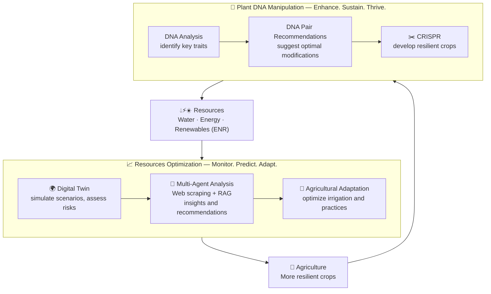
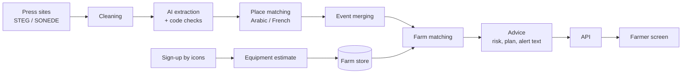
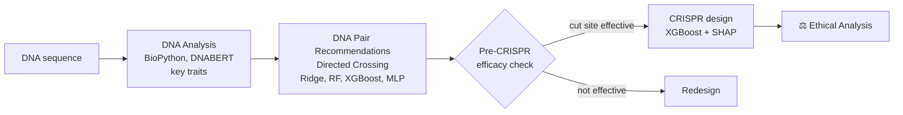
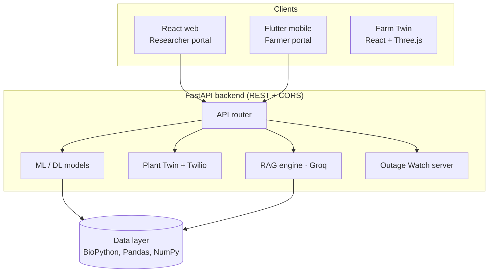

# 🌾💧 AgroNexus

**Smart Synergy for a Sustainable Tunisia**
*Resources optimization × Plant DNA manipulation, in one closed loop.*

  
      

> **Authors:** [team names, school: Esprit School of Engineering] · **Event:** [hackathon name, date]
> *AgroNexus was previously named **AquaSync** (pipeline) and **CropDNA** (genomics platform). The outage module was called "PlantDNA Nexus, Outage watch".*

---

## 📖 Overview

Tunisian agriculture faces two linked pressures: **scarce, unreliable resources** (water, electricity, renewables) and **crops that must become more resilient**. AgroNexus treats them as one loop instead of two separate problems:

1. **Resources Optimization** (*Monitor. Predict. Adapt.*) — understand water and energy, simulate scenarios, advise farmers.
2. **Agriculture** — more resilient crops in the field, monitored by AI.
3. **Plant DNA Manipulation** (*Enhance. Sustain. Thrive.*) — identify traits, recommend DNA pairs, design CRISPR edits for resilient crops.
4. Resilient crops change the resource needs, which closes the loop back to **Resources**.




---

## 🧭 Honesty rules: REAL / SIMULATED / PLANNED

| Label | Meaning |
|---|---|
| ✅ **REAL** | Implemented and working on real data or real models |
| 🧪 **SIMULATED** | Demo only: invented data, simulated clock, nothing sent outside |
| 🗓️ **PLANNED** | Not built yet |

No production use, real users, measured savings or accuracy numbers are claimed unless written in the project notes. Every number added here must be (a) in the notes, (b) a labelled assumption, or (c) `[to fill: source]`.

---

## 🧩 How the pipeline maps to the modules

| Pipeline block | Module in this repo | Status |
|---|---|---|
| 💧⚡☀️ **Resources** (water, energy, ENR) | Farm Twin water/energy model; STEG/SONEDE notices read by Outage Watch | 🧪 twin simulated · ✅ notices real |
| 🌍 **Digital Twin** | **Farm Twin** (React + Three.js, one irrigated farm) and **Plant Twin** (FastAPI, VWC/temperature/humidity, Twilio SMS) | 🧪 simulated |
| 🤖 **Multi-Agent Analysis (Web scraping + RAG)** | Outage Watch scraping and AI extraction (✅ real); RAG engine with Groq (✅ [confirm]); **LangGraph agents** Water, Energy, Crop, Simulation | ✅ scraping/extraction · 🗓️ agents planned |
| 🌱 **Agricultural Adaptation** | Keep / Before / Off equipment plan, alert texts in Arabic, reserve and irrigation rules | ✅ plans and texts · 🧪 sensors simulated |
| 🌾 **Agriculture: resilient crops** | Plant Sound Analysis, Insect Classifier, Plant Disease Detection, farmer mobile app | [to fill per model] |
| 🧬 **DNA Analysis** | DNA Manipulation (BioPython, DNABERT, XGBoost, SHAP) | [to fill] |
| 🧬 **DNA Pair Recommendations** | Directed Crossing (Ridge, RF, XGBoost, MLP) | [to fill] |
| ✂️ **CRISPR** | CRISPR design, preceded by a **pre-CRISPR efficacy check**; Ethical Analysis | [to fill] |
| 🔁 **Loop back to Resources** | Crop DNA outputs feeding water/energy demand | 🗓️ **PLANNED** (crop water need is a labelled simulation input today) |

> The two halves (resources and DNA) share one platform and one backend, but the **data link between them is not built yet**. AgroNexus' Farm Twin does not use any crop DNA output.

---

## 💧 Resources Optimization

### ⚡ Outage Watch (STEG / SONEDE cut alerts)

**Problem.** In Tunisia, STEG (electricity) and SONEDE (water) cuts are announced in the press and on social media, in French and Arabic, as long lists of places (one notice can list about 200 localities). A farmer cannot read them all, and a cut can mean lost cold-chain products, heat-stressed poultry or livestock without water, and missed irrigation.

**Solution.** The system reads the notices, uses AI to extract structured facts (utility, places, time window, type, restoration), merges duplicates into events, matches them with registered farms and tells each farmer what to do, in Arabic, simply and with explanations.

**Farmer journey**
1. **Sign-up by icons**, no typing: animals with a size, crops, water source, backup energy, extras.
2. **Equipment estimate** from a fixed catalog (fans, milking machine, cooling tank, cold room, well pump, drip irrigation…); the farmer confirms or corrects.
3. **When a cut concerns the farm:** no sensors → one general advice message (SMS/WhatsApp, Arabic). With sensors (tank level, battery level) → full plan in the app: **Keep / Before / Off** per equipment, reserve hours vs expected cut.
4. **Every alert explains why:** source, why this place, duration, reserve, probability, assumptions, link to the original notice.

**Example alert:** [to fill: Mornag electricity alert in Arabic + English meaning, and Sousse water message, from `farmer_view.json`]

**Design principle: "code decides, the AI interprets and proposes."** The AI never invents equipment or numbers: it picks from a fixed catalog, and every AI answer is checked by code (invented places, incomplete lists, model overloaded…).



| Status | Items |
|---|---|
| ✅ **REAL** | Reading real notices from Tunisian press sites; AI extraction; Arabic/French place matching; event merging; farm matching; risk, equipment plan and alert texts; sign-up estimate; API; tests |
| 🧪 **SIMULATED** | Farms, sensor readings, the "pretend it is [date]" moment (real notices are from the past), SMS/WhatsApp delivery (text generated, nothing sent) |
| 🗓️ **PLANNED** | LangGraph agents (Water, Energy, Crop, Simulation), feedback loop, real SMS/WhatsApp, full Tunisian place list for sign-up search, discovery of new articles (today a fixed list of 7), map, login |

> Extraction accuracy was checked on **only 7 real articles**. Probabilities and typical equipment/herd values are estimates the farmer confirms. Arabic wording needs native review. STEG/SONEDE have no official API used here.

### 🚜 Farm Twin (digital twin of one irrigated farm)

> ⚠️ **Everything is simulated.** No weather API, database, backend, trained model or DNA pipeline. The "decision" text is an English rule with the numbers it used.

A Three.js farm (left) and a control panel (right), bound to one Zustand store (`src/store/farmStore.js`). The user picks **one renewable source at a time** (solar, wind or hydro); sliders feed explicit formulas that invent a 7-day energy series in kWh. The clock runs about one simulated hour per real second at 1× (also 4× and 12×), with pause.

**Water budget**

| Parameter | Value |
|---|---|
| Tank | 50 m³, starts at 62% |
| Pump | 8 m³/h when on and powered; modes auto / forced on / forced off |
| Crop demand | slider, default 3.5 m³/day (crop types are labels only) |
| Reserve floor | 2 days of demand |
| Refill | starts under the *seuil*, latched, stops at 90% (hard stop 95%) |

The *seuil* is the larger of (shortage days × daily demand) and the 2-day floor, capped so automatic refill still has room.

**Energy production (selected source only)**

| Source | Model | Defaults | "Enough" |
|---|---|---|---|
| ☀️ Solar | 24 × 320 W = 7.68 kW; kWh/day = 24 × 1.6 m² × 20% × 1 kW/m² × (1 − cloud) × sun hours | 30% cloud, 7 h | 15 kWh/day |
| 💨 Wind | ½ρAv³, 6 m rotor, Cp 0.38, ρ 1.225; cut-in 3 / rated 12 / cut-out 25 m/s | 6.5 m/s | 12 kWh/day |
| 💧 Hydro | P = 0.85 × 1000 × 9.81 × flow × head / 1000 | 0.04 m³/s, 8 m | 20 kWh/day |

**Loads and battery**

| Load | Priority | Running kW | Standby kW | When |
|---|---|---|---|---|
| Water pump | critical | 2.2 | 0.02 | follows the pump |
| Irrigation controller | important | 0.15 | 0.01 | follows irrigation |
| Greenhouse ventilation | important | 0.8 | 0.04 | 08:00–20:00 |
| Yard lighting | flexible | 0.36 | 0 | 18:00–23:00 |
| Workshop tools | non-essential | 1.6 | 0.06 | manual, off by default |

Battery 15 kWh, starts at 60%, inverter limit 5 kW. Grid on: all loads served, surplus charges then exports, deficit discharges then imports. Grid off: renewables + battery feed loads up to 5 kW by priority; the rest is *unmet*; unusable surplus is *curtailed*.

**Not in this build:** replayable 48-hour outage script, decision history, rules deferring flexible loads while the grid is on, battery/grid/shed loads in 3D, crop area/type driving demand, biogas, livestock, farm profile, crop DNA and stress tolerance.

### 📡 Plant Twin and farmer mobile app

A background simulation updates plant metrics (VWC, temperature, humidity) every **10 seconds** and sends an SMS via Twilio when a plant is critically dry (**VWC < 15%**).

- 🚜 Simple dashboard: field health and active alerts
- 📡 Live telemetry and historical charts
- 🎵 Push notifications on stress-related acoustic patterns
- 🌍 French and Tunisian Derja
- 📶 Offline-first: capture data and photos offline, auto-sync later

---

## 🌾 Agriculture: monitoring resilient crops

| Module | Purpose | Technology |
|---|---|---|
| 🎵 **Plant Sound Analysis** | Detect plant stress through acoustic signals | CNN14 PANN |
| 🐛 **Insect AI Classifier** | Classify 15 insect species for pest management | ResNet50 (timm, PyTorch) |
| 🍃 **Plant Disease Detection** | Identify wheat leaf diseases from images | CNN (TensorFlow/Keras) |

---

## 🧬 Plant DNA Manipulation



| Module | Purpose | Technology |
|---|---|---|
| 🧬 **DNA Analysis / Manipulation** | Analyze and manipulate sequences, identify key traits | BioPython, XGBoost, DNABERT |
| 🌱 **Directed Crossing** (DNA pair recommendations) | Simulate and plan directed plant crossing | Ridge, RF, XGBoost, MLP |
| 🎯 **Pre-CRISPR efficacy check** | Before CRISPR, check whether the targeted cut site is effective | [to fill: model] |
| ✂️ **CRISPR** | Design edits for resilient crops; explain predictions | XGBoost, SHAP |
| ⚖️ **Ethical Analysis** | Evaluate ethical implications of genetic modifications | RAG + Groq LLM |

---

## 🏗️ System architecture



---

## 🛠️ Tech stack

| Layer | Technologies |
|---|---|
| Web frontend | React 19, Vite 8, TailwindCSS 4, Framer Motion, Chart.js, React Router v7, Lucide React, Axios |
| Farm Twin | React 19, Vite 8, Three.js (React Three Fiber, Drei), Zustand |
| Mobile | Flutter 3.x |
| Backend | FastAPI 0.109, Uvicorn, Pydantic v2, Twilio, python-dotenv, wkhtmltopdf |
| ML / DL / AI | TensorFlow/Keras, PyTorch/timm, XGBoost, scikit-learn, BioPython, DNABERT, SHAP, CNN14 PANN, RAG (Groq) |
| Outage Watch | requests, BeautifulSoup, pydantic, rapidfuzz, Gemini or Groq free tier, standard-library server; UI designed and coded with Antigravity |
| Data | Pandas, NumPy, OpenPyXL |

---

## 🔌 API

| Method | Endpoint | Description |
|---|---|---|
| GET | `/api/plants` | All plant states (VWC, temperature, humidity, status) |
| — | [to fill: 4 Outage Watch endpoints] | [request/response one-liners from notes] |

Data contracts: `farmer_view.json`, `signup_options.json`.

---

## 🚀 Quick start

> 🔐 **Never commit or paste API keys.** Use environment variables only.

```powershell
# Backend
pip install -r requirements.txt
$env:GROQ_API_KEY = "<your key>"     # plus TWILIO_* if SMS is used
uvicorn main:app --reload
```
```bash
# Researcher web app and Farm Twin (each folder)
npm install
npm run dev          # Farm Twin on http://localhost:5173
```
```bash
# Farmer mobile app (Flutter SDK 3.x+)
cd mobile_app && flutter pub get && flutter run
```

Outage Watch: [to fill: offline demo, farm demo, server, tests, from notes section 6].

---

## 🗂️ Project structure

```
AgroNexus/
├── backend/            # FastAPI: RAG, Plant Twin, ML routers
├── frontend/           # React researcher portal
├── mobile_app/         # Flutter farmer app
├── outage_watch/       # [to fill: file map from notes]
├── farm_twin/          # Three.js digital twin
│   └── src/{store/farmStore.js, modules/{energy,water,pump}, dashboard, scene}
└── docs/pipeline.jpg
```

## 🧪 Tests

- Outage Watch: [to fill: test files and counts]
- Farm Twin: no test script yet

---

## ⚠️ Limitations and honest notes

- Outage Watch depends on press notices (no official API); some notices list "non-exhaustive" zones.
- Extraction checked on 7 articles only; probabilities and equipment values are estimates.
- Farm Twin: one renewable source at a time, flat daily averages for wind and hydro, simulated data only.
- The DNA half and the resources half are not yet connected by data.
- Arabic and Derja texts need native review.

## 🗓️ Roadmap

1. Real SMS/WhatsApp sending
2. LangGraph agents (Water, Energy, Crop, Simulation) to complete the Multi-Agent Analysis block
3. Feedback loop on real cut durations
4. Full Tunisian place list, new-article discovery, map, login
5. Farm Twin: 48-hour outage script, decision history, deferral rules, battery/grid in 3D
6. **Close the loop:** feed crop DNA results (stress tolerance, growth stages) into crop water need, once documented in the repo

## 👥 Team, license, acknowledgements

- **Team:** alorAI
